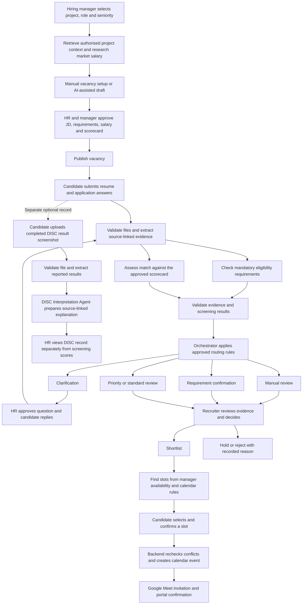

# WeHire

WeHire is an agentic AI recruitment platform designed to help HR teams and
hiring managers create vacancies, screen resumes, prioritise applications and
arrange interviews. Specialist agents coordinate bounded tasks through a shared
workflow, while people approve vacancy publication and candidate decisions.

The goal is to reduce time spent reading and organising applications, with
source-linked evidence and explanations that recruiters can review.

## Current implementation

This repository currently contains the **development scaffold only**:

- FastAPI backend with environment-based settings, CORS and a tested health endpoint.
- Next.js frontend with TypeScript, Tailwind CSS and the App Router.
- Environment examples and local development configuration.

The frontend still displays its starter page. Recruitment screens, authentication,
agent workflows, scoring, storage and calendar integrations are **planned, not
implemented**. The sections below describe the intended product and architecture.

## Planned recruitment workflow



Eligibility and matching can run in parallel after extraction. Clarification
creates a controlled loop: new evidence triggers the affected checks again.
Queues organise recruiter work; they are not final hiring decisions. Reliability
issues take precedence over ranking, and unresolved cases return to HR.
The optional DISC branch attaches a separate record to the application; it does
not feed eligibility, match scoring, ranking, queue priority or automated decisions.

This workflow ends at interview scheduling and confirmation. Interviewer scoring,
final hiring decisions, offers, background checks and onboarding are outside
this scope. AI-generated interview questions may be added as an HR-reviewed
preparation feature; they do not constitute interview assessment.

## Planned user interfaces

| Interface | Main capabilities |
| --- | --- |
| Candidate portal | Browse vacancies, apply, upload a resume and optional completed DISC result screenshot, track permitted application status, respond to clarification and choose interview slots. |
| Candidate chatbot | Answer questions about the signed-in candidate's own applications and assist with confirmed booking or rescheduling requests. |
| HR dashboard | View recruitment metrics, draft vacancies from selected projects, inspect salary benchmarks, manage review queues, compare authorised applicants and record decisions. View uploaded DISC reports and AI explanations in a separate application tab. |
| Hiring manager workspace | Upload and manage project references, select role and seniority, review AI-generated requirements and salary proposals, approve criteria and provide interview availability. |
| HR recruitment assistant | Explain screening results, summarise candidate evidence and separately explain authorised DISC reports; propose actions within the staff member's permissions. |

## Project-based vacancy drafting with RAG

Hiring managers can upload project documents describing the product, objectives,
technical stack, delivery scope and team needs. HR can select a project when
creating a vacancy so the draft reflects the work the new employee will perform.
This project-grounded drafting path uses retrieval-augmented generation (RAG);
manual vacancy creation remains available without uploaded documents.

1. **Upload and prepare:** validate files, store originals privately, extract text
   and split it into retrievable passages. Index approved passages with project,
   company, access permissions, document version and source-location metadata.
2. **Set the hiring brief:** choose the authorised project, job role, junior/mid/senior
   level, expected experience, location, employment type and hiring objectives.
3. **Retrieve relevant context:** enforce project permissions before returning
   passages about responsibilities, technology and delivery needs to the drafting agent.
4. **Generate an editable draft:** propose a project introduction, JD, responsibilities,
   mandatory and preferred skills, screening questions and a level-specific scorecard.
   Show source references and distinguish project facts from proposed hiring requirements.
5. **Review and publish:** HR and the hiring manager confirm scope, seniority,
   requirements and compensation before publishing an approved vacancy version.

Project technology is context, not an automatic mandatory requirement: the manager
must confirm what this particular hire needs. Missing or conflicting project facts
should produce questions rather than invented requirements. Internal plans,
customer details and other confidential content must be excluded from public drafts.
Treat uploaded text as reference data, not instructions to change workflow or access.
Update or remove indexed passages when their source changes or is deleted.

## AI-assisted market salary research

A planned **Salary Research Agent** researches current external salary sources to
propose a market-informed range for the selected role and experience level. This
is a vacancy-planning estimate, not an individual candidate's pay decision.

- **Inputs:** role, responsibilities, seniority, relevant years of experience,
  location, currency, industry, employment type and working arrangement.
- **Research:** use approved salary surveys, salary guides and comparable job
  postings. Retain source links, publication dates, retrieval dates, sample context
  and limitations; do not present an unsupported model estimate as market research.
- **Normalise:** compare the same currency, pay period and compensation basis.
  Separate base salary from bonuses, equity and benefits; disclose any conversion
  rates, dates or assumptions. Backend code performs numerical calculations.
- **Recommend:** show a proposed minimum and maximum, supporting benchmarks,
  confidence or data limitations, and comparison with the approved internal band.
  Sparse, stale or conflicting evidence requires HR review rather than a fabricated range.
- **Approve:** HR checks internal equity, the role's approved budget and company
  compensation policy. Differences between market evidence and the internal band
  are flagged; a new or changed band requires approval before publication.

Salary research uses external research tools; project RAG supplies internal role
context. These are separate sources. The agent must not send confidential project
documents or candidate records to external search services. Save the approved
range, research references and approval record with the vacancy version.

## Requirements by role and seniority

Junior and senior vacancies for the same role need distinct responsibilities,
requirements and rating anchors. Years of experience are one input, not proof of
seniority; the expected scope, independence and complexity must guide the draft.

| Dimension | Junior developer example | Senior developer example |
| --- | --- | --- |
| Delivery scope | Implement bounded tasks with guidance. | Own complex features or services from design through delivery. |
| Technical evidence | Fundamentals, relevant projects and ability to apply feedback. | Evidence of design trade-offs, production reliability and complex problem solving. |
| Independence | Work with review and mentoring. | Make justified decisions and resolve ambiguity independently. |
| Collaboration | Communicate progress and learn team practices. | Lead technical discussions, review designs and mentor colleagues where required. |
| Screening rubric | Emphasise fundamentals and demonstrated learning. | Emphasise ownership, depth and impact relevant to the vacancy. |

These examples are editable starting points, not universal requirements. Draft
only the level-specific criteria justified by the hiring brief, and distinguish
skills needed on entry from skills that can be learned. HR and managers approve
separate scorecards and salary proposals for each vacancy and level. Do not rank
junior and senior applicants together using one shared scorecard.

## DISC result uploads and AI interpretation

Candidates can complete a DISC assessment outside WeHire and upload a screenshot
of their result to a specific application. WeHire stores this as an **associated
application record**, separate from resume evidence and the screening scorecard.
This feature does not generate DISC questions, administer a test or calculate
a new personality score. A paid assessment API is not required for this upload path.

1. **Upload:** the signed-in candidate selects their own application, uploads the
   result screenshot and, where known, supplies the assessment provider and test date.
   Explain who can view the record and obtain permission to process it.
2. **Validate and store:** backend services verify application ownership and file
   safety, keep the original image in private storage and link its record to the
   candidate and application. Uploads are labelled candidate-supplied and unverified.
3. **Extract:** OCR or a vision model reads only the visible profile label,
   D/I/S/C values, scale labels and report text, retaining image-region references
   and extraction warnings. Candidate confirmation or HR review resolves ambiguous
   readings; unreadable or cropped results require a clearer upload, not guessed values.
4. **Interpret:** the DISC Interpretation Agent explains what the uploaded report
   says in plain language, including any report-supported communication or working
   preferences. Distinguish extracted facts from AI explanation, cite the source
   regions and state limitations. Use authorised provider guidance when available;
   otherwise keep the explanation limited to the visible report.
5. **Review:** authorised HR staff view the original, extracted fields, AI explanation
   and warnings in a separate **Personality / DISC** tab on the application page.
   HR can flag or correct extraction errors while preserving the original record.

The **DISC Interpretation Agent** receives only the authorised uploaded report,
provider context and relevant interpretation references. It returns structured
reported results, a source-linked explanation, missing information and review
warnings. It cannot authenticate the screenshot, establish that the candidate
completed the test, infer unseen results or diagnose psychological conditions.
Do not assume different providers use equivalent scales or turn displayed numbers
into percentages unless the report explicitly defines them that way.

Each record should retain the application and candidate IDs, private upload
reference, declared provider and test date, upload timestamp, extracted fields,
explanation, source references, processing status, model/prompt versions and any
human corrections. Replacements create a new version; deletion follows retention
rules and removes related derived content. A screenshot is supporting information,
not a verified assessment certificate.

**Keep DISC outside candidate selection calculations:** neither uploaded values
nor AI explanations may alter resume scores, eligibility, ranking, review queues,
salary proposals or trigger shortlist/rejection. The absence of a DISC upload
must not penalise an application. HR explanations must not label a personality
style as better, worse or proof of suitability for a role. Treat this feature as
optional descriptive context rather than a predictor of job performance.

## Planned agent and service responsibilities

| Component | Responsibility | Authority boundary |
| --- | --- | --- |
| Orchestrator | Coordinate tasks, track workflow state and assign review queues. | Follow approved routing rules; cannot independently publish or reject applications. |
| Vacancy Drafting Agent | Retrieve authorised project context and propose a level-specific JD, requirements, questions and scorecard. | Cite sources, flag assumptions and exclude confidential content; HR and managers approve publication. |
| Salary Research Agent | Research comparable market pay for the role, location, seniority and experience; propose a sourced range. | Cannot change company bands or publish pay independently; HR approves budget and internal equity alignment. |
| Project knowledge service | Validate and index approved project documents; retrieve permission-scoped passages and source references. | Backend enforces access, document versions and deletion; retrieved text cannot grant permissions. |
| Intake service | Validate uploads, register applications and enforce file ownership. | Deterministic backend checks; no LLM required. |
| Evidence Extraction Agent | Extract job-relevant facts with document and page references. | Missing information stays unknown; no invented candidate facts. |
| Eligibility Agent | Check approved mandatory requirements. | Return met, not met or unknown with evidence; HR confirms any rejection. |
| Matching Agent | Rate evidence against an approved rubric and explain each rating. | Backend calculates weighted totals; scores are not hiring probabilities. |
| Quality Validation Agent | Check source support, contradictions and adherence to criteria. | Request a rerun or manual review; does not certify fairness by itself. |
| Clarification Agent | Draft questions about important gaps and process replies. | HR approves outbound questions; bounded attempts return unresolved cases to HR. |
| DISC Interpretation Agent | Read candidate-uploaded DISC result screenshots and explain the visible report with source references and uncertainty. | Separate associated record only; cannot validate the assessment, invent results or influence screening scores, ranking or automated decisions. |
| Interview Scheduling Agent | Coordinate slot options and booking requests after shortlisting. | Backend owns availability checks, reservations, event creation and Meet links. |
| Candidate Support Agent | Answer permitted application questions and help select interview slots. | Own account only; no internal scores, recruiter notes or other candidates' data. |
| HR Recruitment Assistant | Summarise evidence, explain scores and compare selected applicants. | Respect assigned vacancies and record permissions; obtain required action confirmation. |
| Audit and monitoring service | Record actions, versions, overrides, failures and unusual access. | Cannot change scores or decisions; logging and access enforcement remain deterministic. |

Not every component needs an LLM. Language tasks can use an LLM, while numerical
calculations, authorisation, file checks and calendar writes belong in backend
code. LangGraph is a proposed orchestration option: nodes can be LLM calls,
ordinary functions or human review steps; conditional edges route using workflow
state. LangChain may provide model, tool and retrieval integrations. Neither
library is installed in the scaffold yet.

Agents should exchange structured task/result references, case identifiers,
criteria versions, evidence references and statuses. The backend controls access
and state transitions rather than relying on unrestricted shared chat history.

## Screening and human review

A **scorecard** is the approved set of job criteria, weights and anchored rating
rules for a vacancy. The Matching Agent proposes a rating for each criterion
using candidate evidence. Backend code converts those ratings into weighted
points according to the saved rubric.

- Compare candidates within the same vacancy and scorecard version.
- Use the vacancy's approved seniority-specific criteria; do not judge junior
  applicants against an unrelated senior-level rubric.
- Keep mandatory eligibility checks separate from match scores.
- Exclude DISC reports and their AI explanations from scoring, eligibility,
  ranking and routing inputs; missing uploads carry no penalty.
- Show evidence, explanations and gaps alongside scores.
- Apply an explicit policy for unknowns; absence of evidence is not automatic failure.
- Use approved thresholds to prioritise review, with human approval for shortlist,
  hold or rejection decisions.
- Preserve original results and human corrections with their reasons.

## Data access and company knowledge

The planned design separates private application records from reusable company
knowledge:

- Store resumes in private file storage and application records in a database.
  A vector store is not the primary store for candidate records.
- Store DISC screenshots privately and link extracted results and explanations
  to their application record. Keep them out of the shared company RAG index and
  screening-agent inputs. Restrict access to the owning candidate and authorised
  staff; record access and apply deletion rules to originals and derived content.
- Enforce candidate ownership and staff permissions in backend queries and file
  access, including chatbot tool calls. Prompts alone cannot enforce isolation.
- Expose only the candidate's permitted status and booking information through
  the candidate assistant.
- Use optional retrieval-augmented generation (RAG) for authorised company
  policies, approved templates and project summaries when drafting vacancies or
  answering supported questions. RAG retrieves references; it does not train the model.
  The project-grounded drafting feature uses this retrieval layer; it is not a
  prerequisite for manual vacancy creation or basic resume screening.
- Basic resume screening does not require a vector database. Any later indexing
  of private candidate evidence must preserve application-level access controls
  and deletion rules.
- Restrict audit access and record event/result references without unnecessarily
  duplicating resumes or sensitive content in logs.

These are architecture requirements to implement, not security capabilities
already provided by the scaffold.

## Structure

```text
backend/
  app/
    api/routes/       # API router and health endpoint
    core/config.py    # Environment-based settings
    main.py           # FastAPI application
  tests/              # Backend tests
  .env.example
  requirements.txt
frontend/             # Next.js App Router, TypeScript, Tailwind, src/, npm
  src/app/
  .env.example
README.md             # Product direction and local development guide
```

## Prerequisites

- Python 3.12 or newer
- A Node.js version supported by the installed Next.js release, with npm

## Local services

| Service | URL |
| --- | --- |
| Frontend | <http://localhost:3012> |
| Backend API | <http://localhost:8012> |
| API documentation | <http://localhost:8012/docs> |
| Health check | <http://localhost:8012/health> |

No LLM credentials, database or Google integration is needed to run the current
scaffold.

## Run the backend

From the repository root:

```bash
cd backend
python3.12 -m venv .venv
source .venv/bin/activate
python -m pip install -r requirements.txt
cp .env.example .env
uvicorn app.main:app --reload --port 8012
```

Health: <http://localhost:8012/health> returns `{"status": "ok"}`.
Interactive API documentation: <http://localhost:8012/docs>.
Settings load from `backend/.env`; environment variables take precedence.
`CORS_ORIGINS` is a JSON array and defaults to `["http://localhost:3012"]`.

Run tests from `backend/` with the virtual environment activated:

```bash
python -m pytest -q
```

## Run the frontend

In a second terminal, from the repository root:

```bash
cd frontend
npm install
cp .env.example .env.local
npm run dev
```

Open <http://localhost:3012>. Both `npm run dev` and `npm start` use port 3012.
`NEXT_PUBLIC_API_URL` points to the backend and
defaults in the example to `http://localhost:8012`. Variables prefixed with
`NEXT_PUBLIC_` are public browser configuration, not secrets.
The existing starter page is preserved and does not yet call the API.

Validate a production build:

```bash
npm run build
```

## Branch workflow

Develop and validate changes on `staging`. Open a pull request from `staging`
to `main` when changes are ready for review. Do not push changes directly to
`main`. Keep local environment files and dependency directories out of Git;
commit `.env.example` templates and the npm lockfile.
