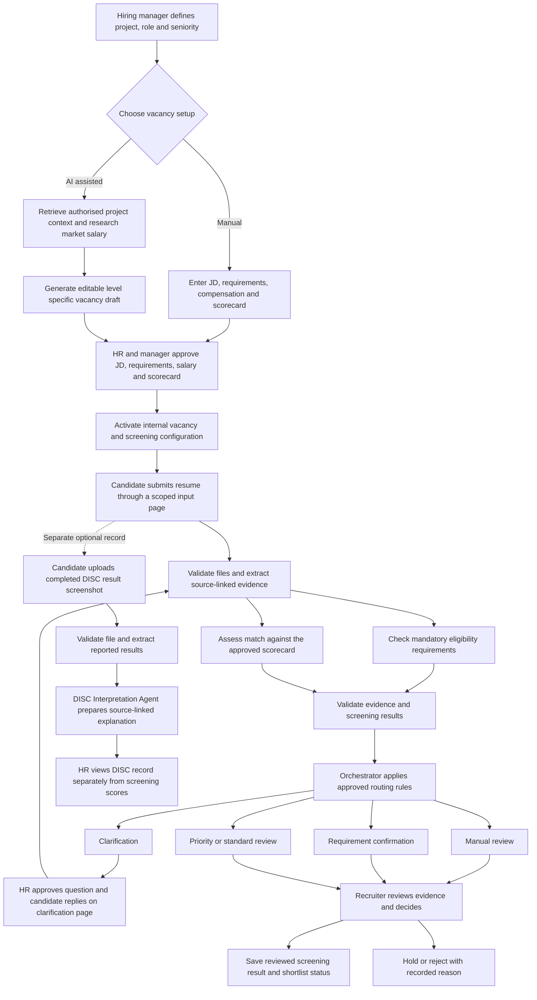

# WeHire

WeHire is an agentic AI recruitment platform designed to help HR teams and
hiring managers create vacancies, screen resumes, prioritise applications and
review candidate screening results alongside separate DISC records. Specialist
agents coordinate bounded tasks through a shared workflow, while people approve
vacancy configuration and candidate decisions.

The goal is to reduce time spent reading and organising applications, with
source-linked evidence and explanations that recruiters can review.

## Current implementation

This repository currently contains the **development scaffold and PostgreSQL foundation**:

- FastAPI backend with environment-based settings, CORS and a tested health endpoint.
- Next.js frontend with TypeScript, Tailwind CSS and the App Router.
- Environment examples and local development configuration.
- Lazy PostgreSQL connection/session management, a shared SQLAlchemy model base,
  an empty models package and Alembic with a no-table baseline migration.

The frontend still displays its starter page. Recruitment screens, authentication,
agent workflows, scoring, storage and DISC interpretation are **planned, not
implemented**. The sections below describe the intended product and architecture.

**Selected database: PostgreSQL.** The planned design stores application records
and original uploaded files in PostgreSQL, using `BYTEA` for binary content and
pgvector for project-document embeddings. Connection/session infrastructure and migrations are implemented; recruitment
tables, file-storage features and the remaining AI libraries are still planned.

## Technology stack and implementation status

| Layer | Technology | Purpose in WeHire | Status |
| --- | --- | --- | --- |
| Frontend | Next.js App Router, React, TypeScript | Three candidate input forms, HR dashboard and hiring-manager workspace. | Installed; starter UI only. |
| Styling | Tailwind CSS | Separate candidate and HR themes and responsive components. | Installed; product screens planned. |
| API | Python 3.12+, FastAPI, Uvicorn | Authenticated endpoints, uploads, workflow requests and result retrieval. | Health endpoint and CORS implemented. |
| Configuration | pydantic-settings | Backend environment configuration and validation. | Implemented for app name and CORS. |
| Request and result validation | Pydantic | Typed API schemas and structured agent results. | Available through FastAPI; recruitment schemas planned. |
| Main database | PostgreSQL | Relational records, versions, permissions, processing jobs and audit events. | Connection infrastructure implemented; application tables planned. |
| Original file storage | PostgreSQL `BYTEA` | Store actual PDF, DOCX, PNG and JPG bytes in a separate content table. | Selected; integration planned. |
| Flexible structured fields | PostgreSQL `JSONB` | Versioned extraction details, warnings and agent result payloads. | Planned; IDs, relationships and core scores remain typed columns/tables. |
| Database access | SQLAlchemy with Psycopg 3 | Database models, transactions, connection pooling and PostgreSQL access. | Implemented; sessions require explicit commit. |
| Schema migrations | Alembic | Reproducible changes to tables, constraints, indexes and extensions. | Configured with a baseline that creates no application tables. |
| Project RAG | pgvector extension and Python integration | Similarity search over permission-scoped project passages. | Proposed; extension and Python dependency not installed. |
| Agent orchestration | LangGraph | Stateful nodes, conditional routing, parallel checks and human review pauses. | Proposed; not installed. |
| Model and tool integrations | Provider SDKs; optional LangChain integrations | Structured model calls, embeddings and approved external research tools. | Providers and models to select; not configured. |
| Text document parsing | `pypdf` and `python-docx` | Extract readable text and source locations from PDF and DOCX uploads. | Proposed; scanned PDFs need an additional OCR/vision path. |
| Image and scanned-document processing | Pillow plus an OCR engine or vision-capable model | Validate images and read scanned resumes or DISC screenshots. | Proposed; OCR/vision provider to select and evaluate. |
| Authentication | Verified identity/session tokens and backend permission checks | Candidate ownership, staff access and assigned-vacancy restrictions. | Provider and implementation planned. |
| Background processing | Python worker with persistent PostgreSQL job records | File extraction, embeddings, research and screening outside upload requests. | Proposed; queue implementation planned. |
| Testing | pytest, HTTPX, FastAPI TestClient | API checks and future ownership, scoring and workflow tests. | Health test implemented; recruitment tests planned. |
| Frontend checks | ESLint, TypeScript and Next.js build | Linting, type validation and production build checks. | Configured in scaffold. |
| Backend dependency management | uv, pyproject.toml and uv.lock | Runtime/dev dependency declarations, locked resolution and local environments. | Migrated from pip requirements; dev tools are grouped separately. |

These choices describe the target architecture. Do not assume adding a library
automatically provides authorisation, reliable retries or a complete RAG system.
Pin compatible dependency versions when the corresponding module is implemented.

## Where each uploaded file and result is stored

The original file, extracted information and AI output are different records.
Store raw bytes in PostgreSQL; do not convert files to Base64 strings for storage.
The vector index contains project passage embeddings, not the original files.

| File or information | PostgreSQL representation | Processing technology | Access and usage |
| --- | --- | --- | --- |
| Resume PDF or DOCX | `documents` metadata linked to an application; `document_contents.file_bytes BYTEA`. | PDF/DOCX parser; OCR/vision for scanned pages; Evidence Extraction Agent. | Owning candidate and authorised staff; extracted job evidence supports screening. |
| Project PDF or DOCX | Project-linked `documents` record, version and `BYTEA` content. | Parser/OCR, passage splitting, embedding model and pgvector retrieval. | Permitted project members and assigned HR; authorised passages support vacancy drafts. |
| DISC screenshot PNG or JPG | Application-linked `documents` record and `BYTEA` content. | Image validation, OCR/vision, field review and DISC Interpretation Agent. | Owning candidate and authorised staff; separate from screening and company RAG. |
| Resume evidence | `application_evidence` records with source document/version/page references; optional JSONB extraction details. | Evidence Extraction Agent and schema validation. | Scoped screening and HR review. |
| Screening criteria and scores | Versioned `scorecards`, `scorecard_criteria`, `screening_results` and per-criterion ratings. | Matching Agent proposes ratings; backend calculates totals. | HR views scores and outcomes; candidate forms show submission acknowledgements only. |
| DISC fields and explanation | Separate `disc_reports` records with document reference, reported fields, source regions, uncertainty and AI version. | DISC Interpretation Agent; preserve human corrections separately. | Never included in screening scores, ranking, queues or salary calculations. |
| Project RAG passages | `project_chunks` with text, document/version reference, project scope and a pgvector embedding. | Embedding model and permission-filtered similarity search. | Backend enforces project access before returning context to a model. |
| Salary evidence and proposal | `salary_research` records with ranges, source URLs/dates, basis, assumptions and approval state. | Approved research tools, Salary Research Agent and deterministic calculations. | HR/manager access; private source files never sent to public search. |
| Workflow and audit history | `workflow_runs`, `processing_jobs` and `audit_events` with scoped result references. | LangGraph, backend worker and audit service. | Restricted staff access; avoid copying file bytes or full private documents into logs. |

Use foreign keys to link these records, including company/project scope where
applicable. A `document_contents` row belongs to one document version. Keep file
bytes separate from metadata so list and dashboard queries do not load the entire
file. Avoid `SELECT *` or automatic ORM loading of binary content in ordinary views.

File upload and processing flow:

```text
Next.js upload form
  -> FastAPI verifies identity, ownership, file type and configured size limit
  -> PostgreSQL saves document metadata and BYTEA content in one transaction
  -> Worker reads the authorised document ID and runs extraction
  -> Screening evidence, project RAG passages or a separate DISC record is saved
  -> HR dashboard retrieves authorised results; input forms show submission acknowledgements
```

The file-download endpoint checks permissions again before returning bytes with
the correct content type. Agents receive bounded, authorised content through
backend tools, never database credentials or unrestricted database access.

Set upload and per-company storage limits, and include binary content in backup,
restore and retention planning. PostgreSQL file storage increases database size;
benchmark realistic uploads and processing workloads before production rollout.
Object storage is not required for the selected initial design.

## Candidate input scope

WeHire uses three limited candidate input pages for this presentation and design:

1. **Candidate Portal Resume Submission:** upload a PDF/DOCX resume for a specific
   HR-configured vacancy and start the screening process.
2. **WeHire Candidate DISC Result Upload:** attach an optional completed external
   DISC screenshot to the same application for separate HR interpretation.
3. **Candidate Portal Clarification Response:** answer an HR-approved request for
   missing evidence; the affected screening checks and score can then be reassessed.

The resume is assumed to be uploaded through this input interface. External job
platforms and their integrations are outside this task. WeHire does not provide a
candidate job board, vacancy search, application-tracking dashboard, candidate
chatbot, profile-management area or candidate screening-result page.

HR provides the vacancy/application context; candidates do not browse jobs or
choose arbitrary application IDs. For the demo, this context may be preconfigured.
Backend authentication or application-bound secure access must still verify the
candidate and ownership for uploads and replies. A hidden form field alone is
not authorisation. Show submission acknowledgements and validation errors inline;
screening scores, outcomes and DISC explanations are reviewed in the HR workspace.

HR keeps manual/AI vacancy drafting, project RAG, salary research, approved
scorecards, screening queues, human outcomes, the separate DISC tab and the HR
assistant. Approving/activating a vacancy means enabling its internal screening
configuration, not publishing a public WeHire job listing.

## Planned recruitment workflow



Eligibility and matching can run in parallel after extraction. Clarification
creates a controlled loop: new evidence triggers the affected checks again.
Queues organise recruiter work; they are not final hiring decisions. Reliability
issues take precedence over ranking, and unresolved cases return to HR.
The optional DISC branch attaches a separate record to the application; it does
not feed eligibility, match scoring, ranking, queue priority or automated decisions.

This workflow ends with the reviewed candidate screening result and the separate
uploaded DISC result and AI explanation. HR records shortlist, hold or rejection
status with a reason; shortlisting does not start another automated stage.
Interview scheduling, time-slot selection, calendar or Gmail invitations, interview
question generation and scoring, final hiring, offers, background checks and
onboarding are outside this scope.

## Step by step implementation plan

Follow these steps as the development checklist for the designed system. They
describe the target delivery sequence. The scaffold and PostgreSQL connection,
session and migration foundation are implemented; recruitment features remain
planned. Step 2's domain tables, processing jobs and audit services are not yet
implemented. Each step identifies its
tech stack, work, responsible component, saved output and completion check.
Technologies named in these steps are planned unless the stack table above marks
them as installed. No additional dependencies are installed by this document.

Build the prerequisites first. During actual application processing, eligibility
and matching (steps 10 and 11) can run in parallel after extraction. The optional
DISC branch (step 16) can run independently once an application exists; it never
blocks or feeds screening. Add audit events and access checks as each module is
built, and verify them throughout rather than waiting until the final step.

### Step 1 Establish identity and access controls

- **Tech stack:** Next.js/React/TypeScript sign-in UI; FastAPI authentication dependencies; verified
  identity/session tokens (provider to select); SQLAlchemy and PostgreSQL for memberships and
  access scope. Backend code enforces ownership and permissions.
- **Build:** HR and hiring-manager sign-in plus authenticated or application-bound
  candidate input access; company, project and assigned-vacancy permissions;
  backend ownership checks for every upload and clarification request.
- **Responsible:** authentication and authorisation services, enforced in backend code.
- **Output:** authenticated actor context and permission-scoped API access.
- **Complete when:** one candidate cannot read another candidate's application,
  uploads or clarification requests, and staff cannot access unassigned records.

### Step 2 Create records storage and workflow foundations

- **Tech stack:** PostgreSQL relational tables, BYTEA for original files and JSONB for flexible agent data;
  SQLAlchemy and Psycopg 3 for transactions; Alembic for migrations; Python job processing and
  persistent workflow/audit records. Database credentials stay in backend environment
  configuration.
- **Build:** records for projects, document versions, vacancies, scorecards,
  applications, evidence, agent runs, reviews and separate DISC reports in PostgreSQL.
  Add document metadata and separate BYTEA content tables, processing states,
  bounded retries and audit events.
- **Responsible:** backend services and the Orchestrator workflow.
- **Output:** persistent case state with task IDs, input/output references and versions.
- **Complete when:** failed work can resume safely, repeated requests do not create
  duplicate results, and each action has a restricted audit trail.

### Step 3 Upload project files and prepare RAG

- **Tech stack:** Next.js/Tailwind project library; FastAPI multipart uploads; PostgreSQL BYTEA originals;
  pypdf/python-docx for text extraction and OCR/vision where required; embedding model plus
  pgvector for authorised project passages. Parsing and embedding providers remain to be
  configured.
- **Build:** the manager's project library, file validation, text extraction,
  pgvector passage indexing, project access filters and source-version handling.
- **Responsible:** Project Knowledge Service.
- **Output:** authorised project passages with document and page references.
- **Complete when:** HR can retrieve relevant project context, inaccessible files
  never reach the model, and source updates or deletion update the index.

### Step 4 Capture the hiring brief and choose the creation path

- **Tech stack:** Next.js App Router, React, TypeScript and Tailwind forms; FastAPI/Pydantic input validation;
  SQLAlchemy/PostgreSQL for the hiring brief and vacancy draft. Manual entry does not require an
  LLM call.
- **Build:** a form for role, project, junior/mid/senior level, responsibilities,
  relevant experience, location, working arrangement, employment type and headcount.
- **Responsible:** hiring manager and HR through the vacancy workspace.
- **Output:** a saved brief and a manual or AI-assisted creation choice.
- **Complete when:** manual entry works without project files or AI research, and
  the AI path receives explicit role scope and seniority rather than guessing them.

### Step 5 Research and review the proposed salary

- **Tech stack:** Salary Research Agent using the selected LLM SDK and approved web-search/research tools;
  Python numerical calculations; PostgreSQL for source URLs, dates, proposals and approvals;
  Next.js for the evidence and salary review screen. Research provider is not selected yet.
- **Build:** approved external source lookup, comparable-role filtering,
  normalisation of pay basis and comparison with the internal band and budget.
- **Responsible:** Salary Research Agent, calculation service and HR approver.
- **Output:** a proposed range with source URLs, dates, assumptions, limitations
  and approval status; manual compensation entry remains available.
- **Complete when:** weak evidence stays pending, band conflicts are flagged, and
  no range is activated for use without approval. Private project and candidate data must
  not be sent to external search services.

### Step 6 Draft the JD and level specific screening setup

- **Tech stack:** Vacancy Drafting Agent with a structured-output LLM; project context retrieved through
  pgvector; Pydantic draft schemas; PostgreSQL for JD/scorecard versions; Next.js/React editors
  for requirements, weights and rating anchors. LangChain integrations are optional.
- **Build:** editable AI drafts using the brief and authorised project passages,
  including responsibilities, mandatory/preferred criteria and screening questions.
- **Responsible:** Vacancy Drafting Agent with HR and hiring-manager review.
- **Output:** the JD plus a proposed scorecard containing each criterion, its
  weight and evidence-based rating anchors. Mandatory eligibility rules are separate.
- **Complete when:** weights total 100%, junior and senior expectations differ
  appropriately, citations support project facts and assumptions are visible.

### Step 7 Approve and activate the internal vacancy

- **Tech stack:** Next.js review/preview screens; FastAPI permission and approval checks; SQLAlchemy
  transactions and PostgreSQL versioned records/audit events. Internal activation is a
  deterministic backend action after human approval.
- **Build:** draft editing, approval history, internal configuration preview and activation controls.
- **Responsible:** HR and hiring manager approve; backend activates the approved version.
- **Output:** an active internal vacancy with saved JD, salary, input-form and scorecard versions.
- **Complete when:** unapproved edits cannot become active, candidate input pages
  expose no confidential project details, and screening uses the approved snapshot.

### Step 8 Receive and validate applications

- **Tech stack:** Next.js candidate form and browser multipart uploads; FastAPI UploadFile with python-multipart
  (planned dependency); backend file-type/size and malware checks (scanner to select);
  PostgreSQL document metadata and separate BYTEA content rows.
- **Build:** the scoped Resume Submission page with resume upload, minimal identity
  fields, a processing notice and an inline receipt. No job search or tracking page.
- **Responsible:** candidate resume input page and deterministic Intake service.
- **Output:** an application ID, authorised PostgreSQL document reference, BYTEA
  resume content and validation status.
- **Complete when:** ownership and file-safety checks run before processing, unsafe
  or unreadable files reach manual handling, and candidates can view only their records.

### Step 9 Extract source linked resume evidence

- **Tech stack:** pypdf and python-docx document parsing; selected OCR/vision tool for scans; Evidence
  Extraction Agent using the configured LLM; Pydantic evidence schemas; PostgreSQL source
  references and extraction results. Run processing in the background worker.
- **Build:** structured extraction of job-relevant experience, skills, projects
  and application answers, with source locations and extraction warnings.
- **Responsible:** Evidence Extraction Agent.
- **Output:** versioned evidence records and explicitly missing or uncertain facts.
- **Complete when:** reviewers can open the supporting source, missing facts are
  not invented and the agent receives no DISC records as screening evidence.

### Step 10 Check mandatory eligibility

- **Tech stack:** Eligibility Agent with Pydantic met/not met/unknown outputs; Python rule checks for objective
  requirements; LLM-assisted interpretation when needed; PostgreSQL evidence and approved rule
  versions. LangGraph can run this node alongside matching.
- **Build:** evaluation of each approved mandatory rule against extracted evidence.
- **Responsible:** Eligibility Agent and deterministic rule checks where applicable.
- **Output:** met, not met or unknown per rule, with evidence references.
- **Complete when:** missing evidence yields unknown, not met requires affirmative
  evidence, and no result automatically rejects the candidate.

### Step 11 Calculate and explain the resume match

- **Tech stack:** Matching Agent with structured LLM ratings; Python Decimal-based weighted calculations and
  explicit unknown-evidence rules; PostgreSQL scorecard, criterion ratings and result versions.
  The backend calculates totals; the model supplies supported ratings and explanations.
- **Build:** criterion ratings against the approved level-specific rubric;
  backend calculation of weighted points and same-vacancy ranking inputs.
- **Responsible:** Matching Agent proposes ratings; backend calculates totals.
- **Output:** criterion ratings, points, total, evidence links and information gaps.
- **Complete when:** totals can be reproduced from the saved rubric, unknowns
  follow the approved policy and DISC never changes the score or ranking.

### Step 12 Validate screening reliability

- **Tech stack:** Quality Validation Agent using evidence-aware LLM checks plus deterministic Python/Pydantic
  schema and version validation; LangGraph rerun/manual-review routes; PostgreSQL warnings and
  run history.
- **Build:** source-support, contradiction, completeness and criteria-adherence checks.
- **Responsible:** Quality Validation Agent with deterministic schema/version checks.
- **Output:** passed checks, warnings, a bounded rerun request or manual-review status.
- **Complete when:** unsupported claims and mismatched scorecard versions cannot
  pass silently, and repeated failures hand control to HR.

### Step 13 Assign the recruiter review queue

- **Tech stack:** LangGraph conditional edges and typed workflow state; deterministic Python routing rules;
  PostgreSQL queue assignments and warnings; Next.js/React queue tables. Model outputs do not
  override configured routing precedence.
- **Build:** approved routing precedence for manual review, clarification,
  requirement confirmation, priority review and standard review.
- **Responsible:** Orchestrator applying configured backend routing rules.
- **Output:** one primary queue with all additional warnings preserved.
- **Complete when:** reliability issues take priority over ranking, thresholds
  are vacancy-specific and DISC presence or values do not affect routing.

### Step 14 Resolve important missing information

- **Tech stack:** Clarification Agent using structured LLM question drafts; Next.js HR approval and candidate
  reply forms; FastAPI endpoints; PostgreSQL reply/evidence records and deadlines; LangGraph
  persisted pauses and bounded rerun loops.
- **Build:** standard clarification drafts, HR approval, a scoped Clarification Response page,
  response deadlines and bounded follow-up attempts.
- **Responsible:** Clarification Agent, HR reviewer and candidate.
- **Output:** new evidence or an unresolved case returned to HR.
- **Complete when:** replies rerun affected eligibility/matching checks and quality
  validation before queue reassignment; silence is not silently treated as failure.

### Step 15 Review and save the candidate screening result

- **Tech stack:** Next.js/React/Tailwind review dashboard and authorised document viewer; FastAPI/Pydantic
  role-specific responses; SQLAlchemy/PostgreSQL transactions for reviewer decisions, reasons,
  original results and corrections. No LLM decides the final screening outcome.
- **Build:** ranked queues, original-resume viewing, score explanations, authorised
  comparisons and human confirmation of shortlist, hold or rejection status.
- **Responsible:** recruiter or hiring manager within assigned permissions.
- **Output:** reviewed screening result, reason, reviewer and timestamp, preserving
  original AI results and any human corrections.
- **Complete when:** HR can verify every result and review the recorded outcome
  internally. Input pages expose no screening score or outcome; no tracking or scheduling starts.

### Step 16 Attach and explain the optional DISC result

- **Tech stack:** Next.js DISC upload form and HR review tab; FastAPI ownership/file checks; PostgreSQL BYTEA image
  and separate DISC records; Pillow plus selected OCR/vision tool; DISC Interpretation Agent
  with Pydantic fields and source-region references. Keep this service/workflow separate from
  the screening graph.
- **Build:** candidate screenshot upload, processing permission, private PostgreSQL
  BYTEA content, OCR/vision extraction, field review and a separate Personality / DISC tab.
- **Responsible:** upload service, HR field reviewer and DISC Interpretation Agent.
- **Output:** an application-linked record containing the original screenshot,
  reported fields, source-linked explanation, uncertainty and version history.
- **Complete when:** unreadable fields require review, uploads remain labelled
  candidate-supplied and unverified, and no DISC data reaches eligibility, scoring,
  ranking, routing or salary calculations. Skipping this step has no penalty.

### Step 17 Add the HR recruitment assistant and dashboard metrics

- **Tech stack:** Next.js/React chat and metric components; FastAPI staff assistant
  endpoints; HR Recruitment Assistant through the selected LLM SDK (optional
  LangChain tools); permission-scoped PostgreSQL queries and retained run records.
- **Build:** an HR assistant for evidence summaries, score explanations and separate
  DISC explanations. Finish the dashboard's screening and DISC metrics. Candidate
  interaction stays within the three input forms; no candidate chatbot is required.
- **Responsible:** HR Recruitment Assistant and dashboard services.
- **Output:** source-linked staff answers and reviewable proposals within assigned
  record permissions, with appropriate human confirmation.
- **Complete when:** HR comparisons use only authorised records and approved
  criteria, and the candidate input pages cannot retrieve internal assistant data.

### Step 18 Verify the complete workflow

- **Tech stack:** pytest, HTTPX/FastAPI TestClient and a real test PostgreSQL instance with pgvector for
  integration checks; controlled model/tool fixtures for repeatable tests; ESLint,
  TypeScript/Next.js production build and manual UI acceptance checks. Cover file-byte round
  trips, source access, scoring, recovery and DISC separation.
- **Build and run:** integration checks for manual/AI vacancy creation, approvals,
  application intake, screening, clarification, human review and separate DISC uploads.
- **Responsible:** development team and HR acceptance reviewers.
- **Output:** repeatable acceptance evidence, failure alerts and operational metrics
  for processing errors, review time and human corrections.
- **Complete when:** access isolation, source traceability, scoring calculations,
  recovery and DISC separation pass checks. Confirm the delivered UI and APIs end
  at screening results and separate DISC records, with no scheduling or invitation module.

### Final deliverables and acceptance checklist

- [ ] HR can approve and activate a manual or project-grounded AI vacancy for internal screening.
- [ ] Salary research is sourced, level-specific and approved before internal vacancy activation.
- [ ] Each vacancy has approved eligibility rules, criteria, weights and rating anchors.
- [ ] Candidates can submit resumes and answer HR-approved clarification requests through scoped input pages.
- [ ] HR can review evidence, rankings and explanations and save a screening outcome.
- [ ] Candidates can upload DISC screenshots as separate optional application records.
- [ ] HR can inspect the original DISC upload and its source-linked AI explanation.
- [ ] The three candidate input pages and HR assistant respect record permissions and result visibility.
- [ ] Audit history, failure recovery and access-isolation checks cover the complete flow.

These boxes remain unchecked until the corresponding feature is implemented and
verified; they do not indicate scaffold completion.

## Design documents

Use these documents alongside the checklist to review the intended flow and screens:

- [Agentic AI screening workflow](output/Agentic_AI_Resume_Screening_Process.pdf)
- [HR dashboard and candidate input prototype](output/WeHire_Recruitment_Portal_Professional_Prototype_Modern.pdf)

## Planned user interfaces

| Interface | Main capabilities |
| --- | --- |
| Resume Submission input | Upload a resume against the assigned vacancy/application context and receive an inline acknowledgement. |
| DISC Result Upload input | Upload an optional external test screenshot for the same application; HR reviews extracted fields and interpretation. |
| Clarification Response input | View one authorised HR-approved question and submit additional screening evidence. |
| HR dashboard | View recruitment metrics, draft vacancies from selected projects, inspect salary benchmarks, manage review queues, compare authorised applicants and record decisions. View uploaded DISC reports and AI explanations in a separate application tab. |
| Hiring manager workspace | Upload and manage project references, select role and seniority, review AI-generated requirements and salary proposals, approve criteria and inspect authorised screening and DISC results. |
| HR recruitment assistant | Explain screening results, summarise candidate evidence and separately explain authorised DISC reports; propose actions within the staff member's permissions. |

## Project-based vacancy drafting with RAG

Hiring managers can upload project documents describing the product, objectives,
technical stack, delivery scope and team needs. HR can select a project when
creating a vacancy so the draft reflects the work the new employee will perform.
This project-grounded drafting path uses retrieval-augmented generation (RAG);
manual vacancy creation remains available without uploaded documents.

1. **Upload and prepare:** validate files, store originals as private PostgreSQL BYTEA records, extract text
   and split it into retrievable passages. Index approved passages with project,
   company, access permissions, document version and source-location metadata.
2. **Set the hiring brief:** choose the authorised project, job role, junior/mid/senior
   level, expected experience, location, employment type and hiring objectives.
3. **Retrieve relevant context:** enforce project permissions before returning
   passages about responsibilities, technology and delivery needs to the drafting agent.
4. **Generate an editable draft:** propose a project introduction, JD, responsibilities,
   mandatory and preferred skills, screening questions and a level-specific scorecard.
   Show source references and distinguish project facts from proposed hiring requirements.
5. **Review and activate:** HR and the hiring manager confirm scope, seniority,
   requirements and compensation before activating the approved internal vacancy.

Project technology is context, not an automatic mandatory requirement: the manager
must confirm what this particular hire needs. Missing or conflicting project facts
should produce questions rather than invented requirements. Internal plans,
customer details and other confidential content must be excluded from public drafts.
Treat uploaded text as reference data, not instructions to change workflow or access.
Update or remove indexed passages when their source changes or is deleted.

## AI-assisted market salary research

A planned **Salary Research Agent** researches current external salary sources to
propose a market-informed range for the selected role and experience level. This
is a vacancy-planning estimate, not an individual candidate's pay decision.

- **Inputs:** role, responsibilities, seniority, relevant years of experience,
  location, currency, industry, employment type and working arrangement.
- **Research:** use approved salary surveys, salary guides and comparable job
  postings. Retain source links, publication dates, retrieval dates, sample context
  and limitations; do not present an unsupported model estimate as market research.
- **Normalise:** compare the same currency, pay period and compensation basis.
  Separate base salary from bonuses, equity and benefits; disclose any conversion
  rates, dates or assumptions. Backend code performs numerical calculations.
- **Recommend:** show a proposed minimum and maximum, supporting benchmarks,
  confidence or data limitations, and comparison with the approved internal band.
  Sparse, stale or conflicting evidence requires HR review rather than a fabricated range.
- **Approve:** HR checks internal equity, the role's approved budget and company
  compensation policy. Differences between market evidence and the internal band
  are flagged; a new or changed band requires approval before internal vacancy activation.

Salary research uses external research tools; project RAG supplies internal role
context. These are separate sources. The agent must not send confidential project
documents or candidate records to external search services. Save the approved
range, research references and approval record with the vacancy version.

## Requirements by role and seniority

Junior and senior vacancies for the same role need distinct responsibilities,
requirements and rating anchors. Years of experience are one input, not proof of
seniority; the expected scope, independence and complexity must guide the draft.

| Dimension | Junior developer example | Senior developer example |
| --- | --- | --- |
| Delivery scope | Implement bounded tasks with guidance. | Own complex features or services from design through delivery. |
| Technical evidence | Fundamentals, relevant projects and ability to apply feedback. | Evidence of design trade-offs, production reliability and complex problem solving. |
| Independence | Work with review and mentoring. | Make justified decisions and resolve ambiguity independently. |
| Collaboration | Communicate progress and learn team practices. | Lead technical discussions, review designs and mentor colleagues where required. |
| Screening rubric | Emphasise fundamentals and demonstrated learning. | Emphasise ownership, depth and impact relevant to the vacancy. |

These examples are editable starting points, not universal requirements. Draft
only the level-specific criteria justified by the hiring brief, and distinguish
skills needed on entry from skills that can be learned. HR and managers approve
separate scorecards and salary proposals for each vacancy and level. Do not rank
junior and senior applicants together using one shared scorecard.

## DISC result uploads and AI interpretation

Candidates can complete a DISC assessment outside WeHire and upload a screenshot
of their result to a specific application. WeHire stores this as an **associated
application record**, separate from resume evidence and the screening scorecard.
This feature does not generate DISC questions, administer a test or calculate
a new personality score. A paid assessment API is not required for this upload path.

1. **Upload:** the candidate opens the scoped DISC Result Upload page for their
   assigned application, uploads the screenshot and, where known, supplies the
   assessment provider and test date.
   Explain who can view the record and obtain permission to process it.
2. **Validate and store:** backend services verify application ownership and file
   safety, keep the original image in a private PostgreSQL BYTEA content row and link its record to the
   candidate and application. Uploads are labelled candidate-supplied and unverified.
3. **Extract:** OCR or a vision model reads only the visible profile label,
   D/I/S/C values, scale labels and report text, retaining image-region references
   and extraction warnings. HR reviews ambiguous readings; unreadable or cropped
   results require a clearer upload, not guessed values. No separate candidate
   extraction-review page is required.
4. **Interpret:** the DISC Interpretation Agent explains what the uploaded report
   says in plain language, including any report-supported communication or working
   preferences. Distinguish extracted facts from AI explanation, cite the source
   regions and state limitations. Use authorised provider guidance when available;
   otherwise keep the explanation limited to the visible report.
5. **Review:** authorised HR staff view the original, extracted fields, AI explanation
   and warnings in a separate **Personality / DISC** tab on the application page.
   HR can flag or correct extraction errors while preserving the original record.

The **DISC Interpretation Agent** receives only the authorised uploaded report,
provider context and relevant interpretation references. It returns structured
reported results, a source-linked explanation, missing information and review
warnings. It cannot authenticate the screenshot, establish that the candidate
completed the test, infer unseen results or diagnose psychological conditions.
Do not assume different providers use equivalent scales or turn displayed numbers
into percentages unless the report explicitly defines them that way.

Each record should retain the application and candidate IDs, private upload
reference, declared provider and test date, upload timestamp, extracted fields,
explanation, source references, processing status, model/prompt versions and any
human corrections. Replacements create a new version; deletion follows retention
rules and removes related derived content. A screenshot is supporting information,
not a verified assessment certificate.

**Keep DISC outside candidate selection calculations:** neither uploaded values
nor AI explanations may alter resume scores, eligibility, ranking, review queues,
salary proposals or trigger shortlist/rejection. The absence of a DISC upload
must not penalise an application. HR explanations must not label a personality
style as better, worse or proof of suitability for a role. Treat this feature as
optional descriptive context rather than a predictor of job performance.

## Planned agent and service responsibilities

| Component | Responsibility | Authority boundary |
| --- | --- | --- |
| Orchestrator | Coordinate tasks, track workflow state and assign review queues. | Follow approved routing rules; cannot independently activate vacancies or reject applications. |
| Vacancy Drafting Agent | Retrieve authorised project context and propose a level-specific JD, requirements, questions and scorecard. | Cite sources, flag assumptions and exclude confidential content; HR and managers approve internal activation. |
| Salary Research Agent | Research comparable market pay for the role, location, seniority and experience; propose a sourced range. | Cannot change company bands or publish pay independently; HR approves budget and internal equity alignment. |
| Project knowledge service | Validate and index approved project documents; retrieve permission-scoped passages and source references. | Backend enforces access, document versions and deletion; retrieved text cannot grant permissions. |
| Intake service | Validate uploads, register applications and enforce file ownership. | Deterministic backend checks; no LLM required. |
| Evidence Extraction Agent | Extract job-relevant facts with document and page references. | Missing information stays unknown; no invented candidate facts. |
| Eligibility Agent | Check approved mandatory requirements. | Return met, not met or unknown with evidence; HR confirms any rejection. |
| Matching Agent | Rate evidence against an approved rubric and explain each rating. | Backend calculates weighted totals; scores are not hiring probabilities. |
| Quality Validation Agent | Check source support, contradictions and adherence to criteria. | Request a rerun or manual review; does not certify fairness by itself. |
| Clarification Agent | Draft questions about important gaps and process replies. | HR approves outbound questions; bounded attempts return unresolved cases to HR. |
| DISC Interpretation Agent | Read candidate-uploaded DISC result screenshots and explain the visible report with source references and uncertainty. | Separate associated record only; cannot validate the assessment, invent results or influence screening scores, ranking or automated decisions. |
| HR Recruitment Assistant | Summarise evidence, explain scores and compare selected applicants. | Respect assigned vacancies and record permissions; obtain required action confirmation. |
| Audit and monitoring service | Record actions, versions, overrides, failures and unusual access. | Cannot change scores or decisions; logging and access enforcement remain deterministic. |

Not every component needs an LLM. Language tasks can use an LLM, while numerical
calculations, authorisation, file checks and application record updates belong in backend
code. LangGraph is a proposed orchestration option: nodes can be LLM calls,
ordinary functions or human review steps; conditional edges route using workflow
state. LangChain may provide model, tool and retrieval integrations. Neither
library is installed in the scaffold yet.

Agents should exchange structured task/result references, case identifiers,
criteria versions, evidence references and statuses. The backend controls access
and state transitions rather than relying on unrestricted shared chat history.

## Screening and human review

A **scorecard** is the approved set of job criteria, weights and anchored rating
rules for a vacancy. The Matching Agent proposes a rating for each criterion
using candidate evidence. Backend code converts those ratings into weighted
points according to the saved rubric.

- Compare candidates within the same vacancy and scorecard version.
- Use the vacancy's approved seniority-specific criteria; do not judge junior
  applicants against an unrelated senior-level rubric.
- Keep mandatory eligibility checks separate from match scores.
- Exclude DISC reports and their AI explanations from scoring, eligibility,
  ranking and routing inputs; missing uploads carry no penalty.
- Show evidence, explanations and gaps alongside scores.
- Apply an explicit policy for unknowns; absence of evidence is not automatic failure.
- Use approved thresholds to prioritise review, with human approval for shortlist,
  hold or rejection decisions.
- Preserve original results and human corrections with their reasons.

## Data access and company knowledge

The planned design separates private application records from reusable company
knowledge:

- Store original resumes, project files and screenshots in PostgreSQL BYTEA content
  rows, with separate metadata and application/project ownership links. Application
  records also live in PostgreSQL; pgvector is not the primary record store.
- Store DISC screenshots as private database content and link extracted results and explanations
  to their application record. Keep them out of the shared company RAG index and
  screening-agent inputs. Restrict access to the owning candidate and authorised
  staff; record access and apply deletion rules to originals and derived content.
- Enforce candidate ownership and staff permissions in backend queries and file
  access, including chatbot tool calls. Prompts alone cannot enforce isolation.
- Candidate inputs expose only assigned submission context, inline upload/reply
  acknowledgements and authorised clarification questions. No tracking dashboard,
  screening results or DISC interpretation is exposed to candidates.
- Use optional retrieval-augmented generation (RAG) for authorised company
  policies, approved templates and project summaries in PostgreSQL with pgvector when drafting vacancies or
  answering supported questions. RAG retrieves references; it does not train the model.
  The project-grounded drafting feature uses this retrieval layer; it is not a
  prerequisite for manual vacancy creation or basic resume screening.
- Basic resume screening does not require a vector database. Any later indexing
  of private candidate evidence must preserve application-level access controls
  and deletion rules.
- Restrict audit access and record event/result references without unnecessarily
  duplicating resumes or sensitive content in logs.

These are architecture requirements to implement, not security capabilities
already provided by the scaffold.

## Structure

```text
backend/
  alembic/            # Migration environment and baseline revision
  alembic.ini         # No database credentials stored here
  app/
    db/               # Shared model base and lazy engine/session helpers
    models/           # Register future table models here
    api/routes/       # API router and health endpoint
    core/config.py    # Environment-based settings
    main.py           # FastAPI application
  tests/              # Backend tests
  .env.example
  pyproject.toml      # Runtime/dev dependencies and tool settings
  uv.lock             # Resolved dependency versions
frontend/             # Next.js App Router, TypeScript, Tailwind, src/, npm
  src/app/
  .env.example
output/               # Workflow and UI prototype PDFs
README.md             # Product direction and local development guide
```

## Prerequisites

- Python 3.12 or newer
- [uv](https://docs.astral.sh/uv/getting-started/installation/) for backend dependency and environment management
- A Node.js version supported by the installed Next.js release, with npm

## Local services

| Service | URL |
| --- | --- |
| Frontend | <http://localhost:3012> |
| Backend API | <http://localhost:8012> |
| API documentation | <http://localhost:8012/docs> |
| Health check | <http://localhost:8012/health> |

No LLM credentials or database is needed to run the current
scaffold.

## Run the backend

From the repository root:

```bash
cd backend
uv sync --locked
cp .env.example .env
uv run --locked uvicorn app.main:app --reload --port 8012
```

`uv sync --locked` creates or synchronises `backend/.venv` from `pyproject.toml`
and `uv.lock`, including the default `dev` group (pytest and HTTPX). It refuses an
outdated lockfile. Keep both files in Git; `.venv/` remains ignored. Do not maintain
a separate hand-edited requirements list.

Add runtime dependencies with `uv add <package>` and development-only dependencies
with `uv add --dev <package>`. These commands update the manifest and lockfile;
review and validate both changes. Use `uv sync --locked --no-dev` for a runtime-only
environment. The backend is configured with `package = false`: run commands from
`backend/` rather than installing the application as a distribution.

Health: <http://localhost:8012/health> returns `{"status": "ok"}`.
Interactive API documentation: <http://localhost:8012/docs>.
Settings load from `backend/.env`; environment variables take precedence.
`CORS_ORIGINS` is a JSON array and defaults to `["http://localhost:3012"]`.

Run tests from `backend/` using the locked development dependencies:

```bash
uv run --locked pytest -q
```

## PostgreSQL setup and migrations

Run all commands below from `backend/` after `uv sync --locked`.
Virtual-environment activation is not required; `uv run` uses `backend/.venv`.
Start a local PostgreSQL server or use an explicitly designated development
instance. No database is created or reset automatically by the application.

Using a PostgreSQL administrator account, create a development role and database
once (skip these commands if your administrator has already provisioned them):

```bash
createuser --pwprompt wehire
createdb --owner=wehire wehire_dev
```

Set `DATABASE_URL` privately in `backend/.env` using the commented format in
`.env.example`, or inject it through the environment. Use the `postgresql+psycopg`
driver and percent-encode password characters such as `@`, `%` and `/`. Never
commit real credentials or print the connection URL. Settings mask the value;
SQL parameter logging is disabled in the connection infrastructure.

```bash
uv run --locked alembic upgrade head
uv run --locked alembic current
uv run --locked alembic history
```

The initial revision `0001_baseline` has no application DDL. Online migration
creates only Alembic's `alembic_version` tracking table. It does not create users,
vacancies, documents, recruitment tables or the pgvector extension.

`app.db.base.Base` supplies shared metadata. Future SQLAlchemy models belong in
`app/models/` and must be imported from its `__init__.py` so Alembic discovers
them. After adding models in later steps, generate and review a migration before
applying it:

```bash
uv run --locked alembic revision --autogenerate -m "describe schema change"
```

`app.db.session.get_engine()` initialises a pooled engine only on database use.
`session_scope()` supports workers/scripts and `get_db_session()` is available as
a future FastAPI dependency. Use synchronous database work in synchronous routes
or a worker, rather than blocking an async route's event loop. Callers explicitly
commit successful writes; failures roll back and sessions always close. App
shutdown disposes any initialised pool. No tables are created on app startup.

`GET /health` remains a liveness endpoint and does not access PostgreSQL. It works
when `DATABASE_URL` is unset or the database server is unavailable; database
operations and migrations require a configured, reachable database.

### Database validation

```bash
uv run --locked pytest -q
```

The normal suite checks health independence, secret masking, SQLAlchemy session
commit/rollback behaviour and offline PostgreSQL migration SQL. The session unit
test uses in-memory SQLite only for lifecycle semantics; it is not proof of
PostgreSQL connectivity.

For a real integration check, have an administrator provision a **new empty test
database**, then privately export `TEST_DATABASE_URL` pointing to it and run:

```bash
uv run --locked pytest tests/test_postgresql.py -q
```

That check connects to PostgreSQL, requires an empty default schema, applies the
baseline twice and verifies only `alembic_version` exists. It never resets or
drops the database and leaves migration history in place. Use a fresh empty test
database for another run. With no `TEST_DATABASE_URL`, it is explicitly skipped.

## Run the frontend

In a second terminal, from the repository root:

```bash
cd frontend
npm install
cp .env.example .env.local
npm run dev
```

Open <http://localhost:3012>. Both `npm run dev` and `npm start` use port 3012.
`NEXT_PUBLIC_API_URL` points to the backend and
defaults in the example to `http://localhost:8012`. Variables prefixed with
`NEXT_PUBLIC_` are public browser configuration, not secrets.
The existing starter page is preserved and does not yet call the API.

Validate a production build:

```bash
npm run build
```

## Branch workflow

Develop and validate changes on `staging`. Open a pull request from `staging`
to `main` when changes are ready for review. Do not push changes directly to
`main`. Keep local environment files and dependency directories out of Git;
commit `.env.example` templates and the npm lockfile.
